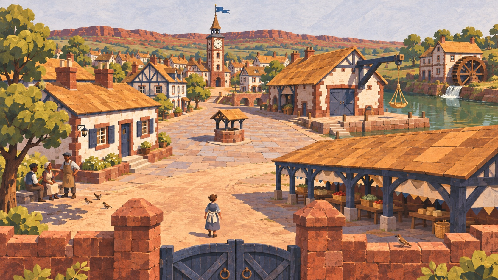
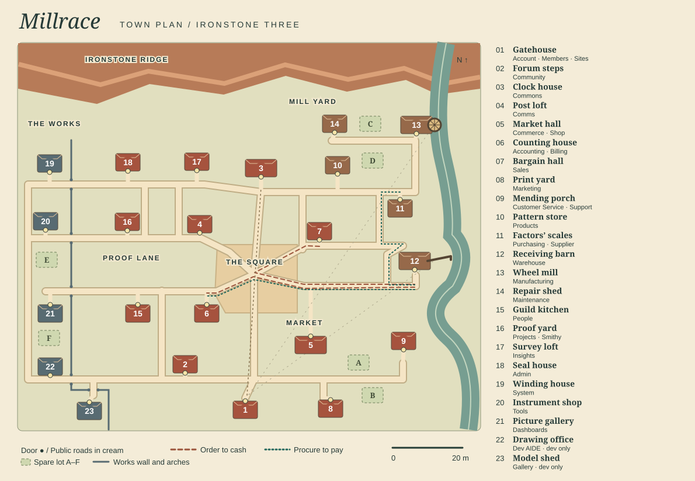

# IronStone THREE

> **In design (before 0.1.0).** THREE is a design so far: this repository has the plans, the concept art and the
> characters' briefs, and nothing to install or run. [MR Moqui](https://github.com/moqui/mr-moqui#readme) and the
> IronStone suites it will build on are in early development and not ready for production: their data model changes
> without migrations and a security review is under way, so they run on development machines only, with no real
> data. The full notice is at the top of the [mr-moqui README](https://github.com/moqui/mr-moqui#readme).

IronStone THREE (*Three-d Hosted-Roleplay Enterprise Ensuite*) is a proposed three.js add-on for
[MR Moqui](https://github.com/moqui/mr-moqui), the Moqui framework in Rust. It brings 3D into business screens where
shape and size matter, and gives the same applications a second front door in a market town called **Millrace**.

## A walk through Millrace

This is the town as it is designed, told as a visit.

Meet under the clock. From the square, you can follow a supplier’s delivery down to the receiving barn, then
cross to the counting house to settle the bill. The timber hoist over the water is a landmark anyone can see.
Inside the barn, its twin tells a warehouse worker how many receipts are waiting. Select the sling and the
real Warehouse screen opens. A customer at the counting house sees their own invoices at the front counter.
The staff ledger stays behind the privacy glass.

Some of the furniture will talk. **Touchmark**, the proof stamp at the Smithy, is to be an Assist specialist you
can ask about a change under review. It can tell you whether a check failed or whether one has yet to report.
The characters take their places in the town first, and their conversations come later.
Walking is optional. The directory takes you straight to the same desks, screens and specialists.

*Two trades share the road between the receiving barn and the counting house.* [Explore the world atlas](plan/design-world.md)

## 3D at the workbench

In ordinary BOSS screens, the same foundation will support previews you can turn in your hand.
A packer could look inside a proposed shipping box before taping it shut. Someone setting up a product could see
its dimensions beside a familiar object. The shop's product page in PASS comes later, and so does editing. Every
task keeps a 2D route.

## Themes, mods and other worlds

How Millrace looks is a theme pack, and there is a plain one with no textures. What it contains will come from
mods: an add-on component gives its own app a building, live decorations and a character through a `mod/`
directory, and the town's own characters will be built the same way. The role briefs of the first seven are in
[mod/cast](mod/cast). Beyond the town are [venues](plan/design-world-venues.md), small worlds for a meeting, with a
big screen for the app being shown.

## State

The project is in design: the documents are drafts and nothing is built. THREE will depend on
[IronStone BOSS](https://github.com/moqui/mr-boss), whose apps it decorates, with
[IronStone PASS](https://github.com/moqui/mr-pass) optional. The planned order is a foundation, the village alone,
the first viewers in BOSS screens, interiors and live decorations, people, sound and venues, visitors from outside,
and then mods opened to other components.

- [Concept](plan/concept.md): what THREE is for and what it is not.
- [World atlas](plan/design-world.md): the town, its [buildings](plan/design-world-buildings.md), the
  [first three interiors and the review walk](plan/design-world-interiors.md), its
  [characters](plan/design-world-agents.md) and the [venues](plan/design-world-venues.md).
- [Technical design](plan/design-technical.md): how rendering, permissions, shared spaces, theme packs and mods fit
  together.

## License and Contributing

[CC0 1.0 Universal with a Grant of Patent License](LICENSE.md). To contribute code, sign
[AUTHORS.md](AUTHORS.md) in a commit from the account that submits the pull request; its Contributing
section has the details.
