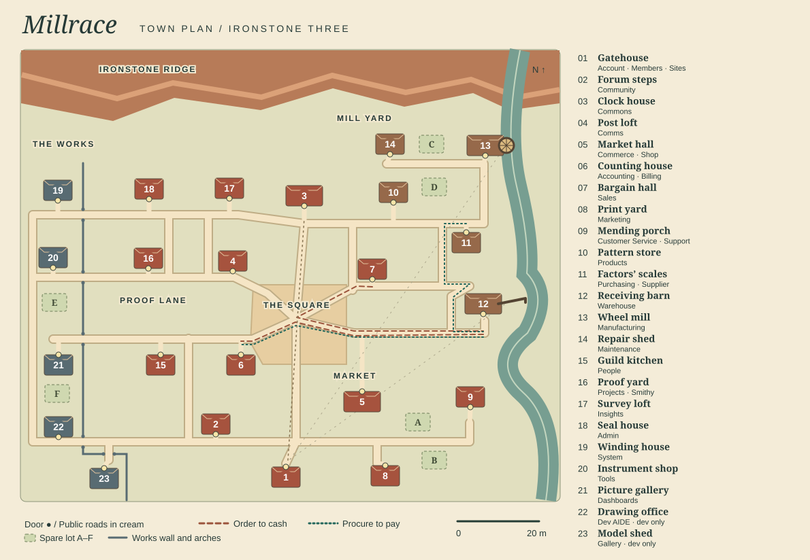

# Millrace · IronStone THREE world atlas

Stand just inside the south gate. Straight ahead, the clock face is a pale disc against a seam of red rock. To the right, a barn sticks one black timber out over the landing like a fishing rod. Beyond it, a wheel dips its paddles into the millrace. A person giving directions has three good sentences already. Meet under the clock. Collect at the hoist. Make at the wheel.


*Arrival study.* The painting sets the silhouette, warmth and order in which the eye finds things. The overhead plate sets walking distances and door locations. Frame the same composition at the game camera’s default 50-degree pitch, with adjustable zoom. Keep the foreground street clear even when the square is busy.

Millrace is a proposed working town for the BOSS divisions, their PASS counters and the framework apps. This atlas supplies the exterior for T1, three furnished interiors for T3, and the building sheets for the rest. The [concept](concept.md) covers the purpose and the [technical design](design-technical.md) owns rendering, services and deployment. The [building sheets](design-world-buildings.md), [first interiors and review walk](design-world-interiors.md), [Assist characters](design-world-agents.md) and [meeting venues](design-world-venues.md) are parts of this atlas.

Millrace is one world among several, drawn by one theme pack among several, and built from mods as every later addition will be. Those three ideas are in the technical design: [worlds](design-technical.md#84-worlds), [theme packs](design-technical.md#16-theme-packs) and [mods](design-technical.md#17-mods).

## 1. Town plan



The dome spans about 180 m. The settled ground occupies roughly 130 × 110 m on the technical design's metre grid. North is up. The ironstone ridge closes the north skyline. The water enters from the northeast, drops at the mill, slows at the receiving landing and leaves to the southeast. Keep all everyday destinations on the near bank. Ridge and river are scenery with low coping stones at the water. A gentle rise toward the clock gives the square a head and a foot. All main streets have a continuous level or ramped line.

Read the plan from the south. The gate opens onto Market Street. The covered market sits to the east, the counting house to the west. Straight on is the square with the clock house at its northern end. Turn east there for the landing and follow the water upstream to the mill yard. The western cross street leads past the post loft to the proof yard, then into the works. The Forum steps open off the gate road. The lower, paved side of each stepped gathering place has seats and room for another person alongside.

| Walk from threshold to threshold | Approximate distance along the drawn streets | What guides the last turn |
| --- | ---: | --- |
| Gate to square centre | 37 m | Clock face stays ahead |
| Square to Billing | 18 m | Black shutters and brass coin above the west counter |
| Square to Warehouse | 51 m | Empty hoist on the skyline, staff door on the landward side |
| Square to Smithy | 42 m | Post loft, then the double chimney on Proof Lane |
| Receiving barn to mill | 76 m | Turn inland at the barn, then north beside the scales to the wheel |
| Square to market meeting porch | 31 m | Two facing benches at the market arcade |

Allow 4 m for cart streets, 3 m for side lanes and at least 2 m clear past a sign or bench. Give a portal a level landing on both sides, with benches and interaction points recessed from the line of travel. Keep roofs below the sightlines from the gate to clock, hoist and wheel. Use the close and district zoom settings to check the three gaps. Interior roofs are omitted and near walls are low in the [camera design](design-technical.md#12-movement-camera-and-physics). A discoverable feature never depends on seeing over another building.

**The works wall.** Winding house, Instrument shop, Picture gallery, Drawing office and Model shed (19 to 23), the framework's own tools, stand behind a slate wall on the west edge. Each lane into the works passes under an arch, and the arches open and close together. Most people have no business there. Closed arches say so once, where five shuttered houses would say it five times. Someone who may enter any of the five finds every arch open. The Seal house, where a business looks after its own users, stays in town beside the Survey loft.

**Spare lots.** Six garden plots, lettered A to F on the plan, are held for buildings that arrive later: two on the market side, two in the mill yard and two inside the works wall. A component with an app of its own claims one by district and house type ([lots](design-technical.md#173-lots-slots-and-generated-rooms)). An unclaimed lot stays a kitchen garden with a low fence. Three buildings are conditional from the start, each drawn only when its component is installed. The Drawing office and the Model shed keep their numbered places, 22 and 23, which are gardens without them. Marble's coach house takes the first market lot.

**Two trades share one street.** Follow the broken ochre line from Sales at the bargain hall through the square to Warehouse for picking and shipping, then back to Accounting for invoice and receipt. Shop at the market is the storefront branch. Help and returns come back through the mending porch. The green dotted route starts at Purchasing, crosses its own Supplier counter for acknowledgement, then runs down to Receiving and Putaway. The bill comes in at the factors' counter and matching and payment belong to the counting house. Brass pavement inlays bear a folded order or a tied bale so the routes still differ in grayscale. Names, all intermediate steps and authorized record links live on the actual Insights maps. The inlays teach a route and execute no work. A viewer also sees a [handcart](#on-the-street) at each handoff they may read. [Customer flow](../../mr-boss/report/insights-flowmap-customer.json) · [Supplier flow](../../mr-boss/report/insights-flowmap-supplier.json) · [Internal flow](../../mr-boss/report/insights-flowmap-internal.json)

## 2. Art direction

| Element | Direction for the artist |
| --- | --- |
| Stone, wood and cloth | Ironstone **#AB694C**, limewash **#F4E8CE**, sawn oak **#987047**, river green **#587E70**, writing ink **#243734**. Use ochre roofs on the market, slate-blue ridges on the works and bare timber ends in the mill yard. Repeat the same cornerstone and door hardware across town. These are the color roles of the `millrace` theme pack. |
| Silhouette and scale | People about 1.7 m tall, with large hands, broad cuffs and simple faces. A street door is 2.4 m high. Most eaves sit at 3–4 m. Clock tip 14 m, hoist tip 8 m, wheel 5 m across. Exaggerate the tool by which a building earns its living, and give each building one emblem that no neighbor or character repeats ([emblem register](design-world-buildings.md#emblem-register)). Let changing roof shapes do the work of extra textures. |
| Lettering | Paint the trade emblem large enough to read from across the square. At approach show the exact localized app name on a level, screen-facing label in the shell typeface, at least 16 CSS px, ink on opaque limewash. Draw the same label on focus. Keep the full name in the directory when a distant sign folds to an emblem. |
| Working screens | A pair of brass corners and an ink rule frame every flat working screen. The frame carries the app title, the return place and a labeled Close control. |
| Light and sky | Late-morning light from the southwest leaves door faces legible. Cloud bands painted inside the dome drift only on higher tiers. The clock may show local time with the zone in its label. Weather has no business meaning. |
| Movement and sound | Let the millwheel turn for pleasure and the pigeon on the counting-house roof change feet. A selected book squares itself against its shelf with one soft tap. Keep motion local and brief. Reduced motion uses the settled pose, labeled focus and immediate travel. Water, timber creak and paper are optional ambience. All speech and effects have a silent route. |

### Sign language

Seven marks tell a person what an object does before they touch it. Use them on the object, on its focus label, in the [HUD](#the-hud-and-the-minimap) action prompt and beside the directory entry.

| Mark | Means | Directory verb |
| --- | --- | --- |
| Projecting book spine | Open a screen | Open |
| Pin or dial | Read a value | Reading |
| Scalloped speech mark | Ask an Assist character | Ask |
| Blank slip under a brass weight | Start a new record, from the app's own quick-create entries | New |
| Wax seal | Something waits for this person's decision | Decide |
| Hourglass or candle | Time left before a date | Due |
| Lantern | A room to meet in | Meet |

Two marks are reserved for the data itself and never used for business. A striped dust sleeve with a small clock means the *reading* is stale. A folded trestle with a wrench means the *reading* failed. The age of work is an hourglass or a candle stub. A failed batch, a failed check or a bounced letter is a successful reading with its own mark.

The Titchfield hall's open ground arcade is why our market has room to talk while the road stays clear. The Lurgashall wheel drove several jobs including a sack hoist. Here the wheel identifies making and the separate waterside jib identifies receiving. Waterside warehouses placed loading directly against the boat. Give the barn its projecting tackle on that face and its pedestrian entrance on the other. [Titchfield Market Hall](https://www.wealddown.co.uk/buildings/market-hall-from-titchfield/) · [Lurgashall Watermill](https://www.wealddown.co.uk/buildings/watermill-from-lurgashall/) · [Canal & River Trust warehouse study](https://canalrivertrust.org.uk/media/document/OxyVe7XLOA0NPhVmzYkFRA/yiOhK5j3PwcxZwUiOezx2Pbc7CbqNR6xhMgVN5T7A78/aHR0cHM6Ly9jcnRwcm9kY21zdWtzMDEuYmxvYi5jb3JlLndpbmRvd3MubmV0L2RvY3VtZW50Lw/018f9b65-60c8-76bf-9933-adfa3fecba67.pdf)

Take three gestures from the games. *Job Simulator* puts the thing you want to use within reach. Tip the nearest ledger toward the hand or focus ring. *Carry On Together* makes awkward loads funny. Let one corner of the sling catch, bob once, and settle on selection without altering a receipt. *Human Resource Machine* gives successive operations fixed places. Keep the stations of every room in the order the work passes through them. The skyline uses the same principle at a distance, with each landmark occupying its own gap. [Owlchemy Labs](https://jobsimulatorgame.com/) · [Carry On Together](https://store.steampowered.com/app/4776500/Carry_On_Together/) · [Tomorrow Corporation](https://tomorrowcorporation.com/humanresourcemachine)

### Theme packs

Everything in this section is the content of one theme pack, `millrace`. A second pack, `millrace-plain`, uses the same models and layouts with every texture removed: flat materials, a plain gradient sky, no painted patterns and no ambience. It is the default on the Low quality tier and the atlas's conformance check. Every sign, state and reading must still be told apart in it, so nothing may differ by texture alone, as the two routes already differ in grayscale. An installation adjusts a pack's settings (accent color, banner or logo, town name, clock face) without touching its art. [Theme pack structure](design-technical.md#16-theme-packs)

### Kit selection

The following files and the included CC0 license texts were checked at the linked creator revisions. Counts are indexed triangles in the source meshes, before instance reuse or conversion. Each sampled asset uses one material.

| Kit and selected files | Treatment | Source and license |
| --- | --- | --- |
| KayKit Medieval Hexagon 1.0, blue watermill (1,921), market (3,125), blacksmith (2,410) | Separate the structures from their tile footprints. Snap entrances to the square metre grid. Recolor one variant. Add the clock face, hoist and proof-yard chimney as distinct pieces. | [Buildings](https://github.com/KayKit-Game-Assets/KayKit-Medieval-Hexagon-Pack-1.0/tree/84fa4e91af6a88989be7c99e0891cede11f2ca38/addons/kaykit_medieval_hexagon_pack/Assets/gltf/buildings/blue) · [license](https://github.com/KayKit-Game-Assets/KayKit-Medieval-Hexagon-Pack-1.0/blob/84fa4e91af6a88989be7c99e0891cede11f2ca38/LICENSE.txt) |
| KayKit Furniture Bits 1.0, book_single (68), chair_stool_wood (216), table_medium (168) | Enlarge the spine slightly and reuse it for working books. Build the adjustable sling, folding ledger, proof tags and state marks from simple geometry. | [Furniture](https://github.com/KayKit-Game-Assets/KayKit-Furniture-Bits-1.0/tree/96d5930a8dbdb363409bbc2d3341718b00e17c9c/addons/kaykit_furniture_bits/Assets/gltf) · [license](https://github.com/KayKit-Game-Assets/KayKit-Furniture-Bits-1.0/blob/96d5930a8dbdb363409bbc2d3341718b00e17c9c/LICENSE.txt) |
| KayKit Adventurers 1.0, Rogue.glb (6,377), skinned and animated | Use the Rig as the first proportion and retargeting sample. Give the civilian figure an apron or plain coat. Keep locomotion and social clips, with a simplified distant figure. | [Character](https://github.com/KayKit-Game-Assets/KayKit-Character-Pack-Adventures-1.0/blob/672074b73ba276876a19e8816ecdc5241817ab47/addons/kaykit_character_pack_adventures/Characters/gltf/Rogue.glb) · [license](https://github.com/KayKit-Game-Assets/KayKit-Character-Pack-Adventures-1.0/blob/672074b73ba276876a19e8816ecdc5241817ab47/LICENSE.txt) |

**One test before T1 commits to the exterior kit.** The hexagon pack's buildings are whole structures made for a strategy map and meant to be seen small. The layouts assume modular pieces that snap to a metre grid, with a 2.4 m door a 1.7 m figure walks up to. Place one converted building at the close zoom beside the figure. If the door, eaves and detail do not hold, build exteriors from a modular CC0 wall, roof and door kit and keep the hexagon pieces for distant scenery. The pack's piece map makes either choice a data change.

These are art selections. T1 measures the converted exterior against the existing targets of 5 MB transferred, 150 draw calls, 300,000 visible triangles, 64 MB GPU memory and 30 fps on the target phone. Each interior adds at most 2 MB of transfer as a target. Instance the repeated fittings and prioritize readable silhouettes over roof trim. The arrival painting is a concept illustration for this document. [Rendering budgets](design-technical.md#5-rendering-core) · [Asset pipeline](design-technical.md#15-assets)

## 3. Buildings and thresholds

The [building register](design-world-buildings.md) uses the numbers on the plan. Its stations follow the current app menus and its objects cite the screens and services that supply them. Each building has a way out at the arrival anchor. An organization binding shows its banner only to members.

**Three door looks.** A street door a person may use has its shutters open and its door painted in the trade color. A door they may not use has its shutters closed and a plain door. It is quiet, not barred, and selecting it names the app and says who grants access. A lock is drawn only on a secured area inside a building the person is already in. So a warehouse worker sees one open house and a calm street, where two looks would show them a row of padlocks.

**Meeting doors.** A lantern bracket on the **street side** marks a separate meeting-room door, on those buildings where an administrator has bound a room. No bracket is drawn for an unbound building. The Travellers’ table and Speakers’ room are bound from the start. A meeting too large for a room goes to a [venue](design-world-venues.md).

Use one village per installation, with one configured PASS site for its counters. Organization banners, room membership and app readings follow the viewer’s active scope. The village grant admits someone to the street and offered front counters. The counter opens the configured site's PASS mount. Accounts, invitations, publication and repository policy decide what the person can read there. The back door uses the staff app grant. Interior doors use the section's actual authorization and menu condition. A hidden area becomes plain wall. For a private-only app the street threshold is the door that stays shuttered. Omit a PASS counter when the selected site lacks its mount. A paired building then uses its staff entrance. A building entirely supplied by an absent component is not placed, its lot stays a garden, and its directory entry disappears.

**A room is larger inside than its house.** The plan draws a house about 7 × 5 m and its room is two to three times that each way. Doors are portals, so the two never have to agree, and the street stays a short walk. Size a room from its stations and no larger. A staff house is about 16 × 12 m. A paired house is about 16 × 15 m, with a 4 m front strip holding the counter on the left, the staff portal in the middle and the meeting door on the right. The receiving barn, with nine queues along its floor, is the largest at 20 × 14 m. The test for any room: all of it fits the frame at the default zoom on a phone held upright, and every station label reads on focus.

A tinted, stippled pane beside the portal lets staff see out. Seen from the public side, it can show anonymous moving figures once T4 exists and unchanging outlines of furniture. No workload-driven movement, colored status, names, work sounds or working screens cross it. An opaque installation setting replaces the whole pane. The camera looks down over low walls, so the veil is a treatment of the whole back zone for a front-office viewer and the pane is where it shows. T3 looks like a furnished room at rest.

**Stations.** A room holds four to seven stations around an open central floor. A station is one piece of furniture for one step of the work: a receiving stand, a banking desk, a quote counter. It carries that step's live readings, a blank slip where the app offers a quick-create, and the books of the menu sections that belong to the step. Stations stand in the order the work passes through them, clockwise from the entrance. Home has the centre desk. One **index cabinet** by the exit holds a labeled book for every menu section in menu order, so the whole app menu is always in one known place. Settings has its cupboard beside it wherever the app offers Settings.

A room nobody has furnished by hand is generated: its stations come from the app's menu and a short grouping list, on the shared floor below. The three [furnished interiors](design-world-interiors.md) show what hand placement adds.

```text
      PAIRED HOUSE · 16 × 15 m             STAFF HOUSE · 16 × 12 m
┌───────────────────────────┐       ┌───────────────────────────┐
│ station 3      secured bay│       │ station 3      secured bay│
│ station 2  Home  station 4│       │ station 2  Home  station 4│
│ station 1    index cabinet│       │ station 1    index cabinet│
│ Settings                  │       │ Settings                  │
├── privacy pane ──────╥────┤       └────────────────────╥──────┘
│ counter         meet door │                        staff IN
└────────╥─────────────╥────┘                 separate street door → room
      public IN       room
```

## 4. Public life and navigation

**At the gate.** A visitor chooses Enter Village, lands facing the clock, and sees the street directory on a tilted map table. A brass swallow perched on its edge can explain the signs. The table itself always works. Select by app name, by trade name or by destination such as “My invoices”. Travel places the person at the appropriate accessible anchor. Selecting a screen opens its real page. The HUD's Square command and the shell palette work from every street and room. The closest matching authorized station owns a screen opened through search. Close the overlay to resume at that station, or at the object that originally opened it. A PASS page opens in the framed window, and in its own tab only where a site's policy forbids framing. Preserve the village tab and focus on the same object when the person returns. [Shell navigation](design-technical.md#7-the-village-as-a-shell-layer)

**Under the arcade.** Two people can stand at the bench and hear each other if they choose to listen and speak. In the first audio phase anyone in the exterior space may receive their voices. The street meeting door leads to a separate chat room with its own call. At a public counter, “Meet here” opens the bound room if the viewer may join. A little counter bell offers the room or the real support/contact page. Ringing it also raises a small flag on the staff side of the pane, which tells anyone working there that a visitor is at the counter. The flag carries no name and no request, and the bell still cannot promise that a clerk is coming. Room sign states are Available, In session, Unavailable and Private, using the call's state only for people allowed to read it. The Travellers’ table and Speakers’ room are the two general meeting places. Bind a division building's bracket to that division’s chat room, with explicit membership. A six-seat ring suggests an ordinary meeting, a twelve-seat hall a larger one. Represent further authorized participants in the roster. Neither number caps the call.

**In a meeting.** Someone joining from the ordinary call screen appears on the same roster, with a little desk plaque in the room where a 3D figure would sit. An empty chair means a place to sit. It makes no claim about other chat-room members. Staff use registered names. An external user chooses “Visitor” or their registered real name for everyone. Bodies, colors and hats are cosmetic. Use text plus a small badge for away, do not disturb, in a call and speaking, as supported by presence/call state. The microphone and listening start independently, both off. Each enclosure has its own audio. Rooms and venues share one set of [meeting furniture](design-world-venues.md#meeting-furniture). [People and sound](design-technical.md#14-audio-and-meetings)

**Working together.** Four small acts need no meeting. *Point* drops a marker on an object that others in the same zone see for a few seconds, which is how one person shows another where something is. *Follow me* walks a colleague's figure beside yours and offers their window the screen you open, if they may open it. *Knock* asks the people in a room to let you join. A few emotes (wave, nod, shrug) say the rest. None of them carries business data.

**On the ridge.** The Commons clock has a large readable face and a row of seven ceramic day tiles. Its public face can always indicate the day. Selecting it opens the directory at Commons Calendar, if allowed. Personal events appear only on the viewer's near label or inside the clock house. The square notice board uses explicitly shared dashboard panels or visible Commons items. A small plate gives the title, source and time. Beside the clock a narrow terrace holds the town's few global readings, each drawn only for a viewer entitled to it: the banner of the active organization, a period hourglass, and a beacon basket for administrators ([street readings](#on-the-street)). The dome is the sky and the far limit and nothing else. An event with a presentation is held in the [cliff theatre](design-world-venues.md#the-four-venues), whose audience chose to be there. The sky carries no system-health information.

**On a bench or in the terminal.** The text directory has the same named places, objects, six data states, door looks, room bindings and Assist actions as the world. It follows app order as an alternative to district order. Search, Tab, Enter and Close cover the entire journey. Navigating to a closed screen restores focus to its launching control. On a phone a real work screen fills the display, with Return to village in reach. A Maps link from the table appears when the framework supplies Maps. The village map and direct travel are available at T1.

**Guided walks.** A walk is a short route with numbered stops, drawn as a ribbon on the ground and as a list in the directory. Each stop has one sentence, a focused object and an optional “try it” that opens the real screen. The [four paper walks](design-world-interiors.md#four-paper-walks) are the first. A walk is data in a mod, so a company writes its own for a new hire: where an order goes, who touches it, which desk is theirs. On any focus label, “What is this?” opens the Knowledge article for that station where one exists, or the local specialist.

### The HUD and the minimap

What belongs to the person rather than to a place sits in a heads-up display over the world. It lies under the shell header and never replaces it. The palette, tray, Assist and account stay where they are.

```text
┌ shell header: palette · tray · Assist · account ───────────────────────────┐
│ Millrace › Counting house › Receivables            ┌─────────────┐         │
│ ⚑ organization · facility                          │   minimap   │         │
│                                                    │    ▲ you    │         │
│                                                    └ N  +  −  ⤢ ─┘         │
│                                                    → Receipt 1042 · 60 m   │
│                   the world                        ▸ 2 overdue             │
│                                                    ▸ 3 approvals           │
│                                                    ▸ Call at 14:00         │
│ Listen off · Mic off                                                       │
│ Street: anyone here may hear you   [1][2][3][4][5] Square · Map            │
│                          Enter: Open Receipts      Directory · Leave       │
└────────────────────────────────────────────────────────────────────────────┘
```

| Element | Shows and does | Source |
| --- | --- | --- |
| Place line | World › building › nearest station. Selecting a part travels there. | The layout and the current route |
| Scope pennant | The active organization, facility or store. Select it to change scope with the app's own selector. The same words sit beside every reading. | The apps' scope selection |
| Minimap | The space around the person, described below. | The current space's layout |
| Waypoint | The tracked item's name, direction and distance. A matching guide line lies on the ground to its door or station. | The item selected in the work tracker |
| Work tracker | Three lines at most, overdue first, with counts. Selecting a line opens the item and tracks it. “More” opens the tray's Today, which stays the full list. | [Shell counts](../../../base/framework/service/org/moqui/ui/ShellServices.xml) (today, overdue, approvals, notifications, chat, email, calls) and mantle.work.WorkEffortServices.get#UserTodayItems |
| Sound | Listening and microphone, the name of the sound space and who can hear in it, and whether the call is being recorded. | Presence and the call |
| Satchel | Up to five record slips the person pinned or just used, on keys 1 to 5. A station that takes that kind of record offers “Open here”. A convenience only. No task needs it. | Shell record links. The pinned list is a new preference. |
| Action prompt | What Enter or a tap does to the focused object, with its sign-language mark: “Open Receipts”, “Ask Tallystick”, “New quote”. | The focused place |
| Travel | Square, Map, Directory, Settings, Leave. | — |

- **It is ordinary page content over the canvas.** Text stays sharp, localized, focusable and readable by a screen reader.
- **Nothing lives only in the HUD.** Each element is a short view of something the tray, the directory or the world also has.
- **It shows the viewer's own information only**, as every reading does.
- **It gets out of the way.** A person chooses full, minimal (minimap, action prompt and sound) or off. It hides while a working window is open, except for sound. M opens the map and 1 to 5 the satchel, in the world's own key scope.
- **On a phone** the minimap folds to a compass button carrying the waypoint arrow, the tracker to one line and the satchel to a drawer. The touch stick and one action button take the lower corners.
- **The theme pack styles it**, and a mod may fill its named slots.

**The minimap** is drawn from the layout of the space the person is in, in the pack's colors, so it cannot drift from the world and it works for rooms, venues and newly claimed lots. The town plan above stays this atlas's illustration. One drawing serves at three sizes: the minimap, the full map (M, or the gate's map table) and the village map of T1.

| | |
| --- | --- |
| Shows | The person and their heading. Buildings by emblem. Each street door as open to them or shuttered. Doorstep baskets with something in them. The waypoint and guide line. Meeting rooms in session that they may join. People they receive in full, as dots, with names on the full map only. The two trade routes on the full map. |
| Never shows | A veiled figure, anything behind the pane for a front-office viewer, or another person's readings. |
| Use | Select a place to travel there, the same fast travel as the palette. Zoom from about 40 m across to the whole town. North stays up, or the map turns with the camera, as the person prefers. |
| Indoors | The room plan: stations by emblem, doors, the line of the pane, and a blank back zone for someone standing in the front. |
| In a venue | The seating plan, with the stage and who is speaking. |
| As text | The directory, ordered nearest first. |

A few personal things stay in the world. The **guide line** is a dotted ribbon from the figure to the tracked item. A **messenger pigeon** lands near the figure when a notification arrives, and selecting it opens the notification. With reduced motion it is a badge on the work tracker and nothing flies. The figure's **pose** says reading (a window is open), in a call or away, to those who may see the figure in full. [HUD design](design-technical.md#75-the-hud-and-the-minimap)

## 5. The village NPCs

A specialist lives where someone would naturally seek advice. At the gate a brass bird reads fingerposts. At the barn a notched tally stick counts a question off against its marks. Counterfoil is a little book tethered to the public cashier's desk with green ribbon. The Smithy's proof stamp strikes a mark when someone asks it to read a change. In the survey loft an angled mirror lets a manager turn a number over and see where it came from.

Each is an Assist agent with its own curated **AGENT.md**. The brief, the physical station and the directory entry identify the same specialist. Select **Ask** to address one privately. Motion signals the local interaction with Assist. The ordinary book, door or instrument next to the character still opens its screen directly. The cast is the first mod, so a component can add a specialist of its own the same way. See the [cast, instruction files and binding design](design-world-agents.md).

## 6. Functional decorations

| State | What the person sees | What the directory reads |
| --- | --- | --- |
| Value | Object at a level, with shape and text for its condition | Actual value, unit, scope and as-of time |
| Zero | Tidy empty cradle, exposed base and small round zero seal | “0 waiting” (or the correctly formatted zero amount) |
| Missing | No variable insert. A fixed label can still open the underlying screen | “No reading configured” |
| Withheld | Closed cover on a known, visible fixture | “Restricted”. An absent place or unseen back zone contributes no entry at all |
| Stale | Last permissible level, striped dust sleeve and small clock | “Last known …”, value and time. Recheck scope before redisplay |
| Failed | Folded wooden trestle with a wrench shape | “Reading unavailable”. The working screen can still be opened if permitted |

Every live object is evaluated as the viewer in the current organization, site, store, facility or repository. Personal work comes first. Each browser draws its own town, so an object on the common street can carry a private reading: it draws a different insert for each authorized person and an empty one for everyone else. The quay hoist is the example. A warehouse worker sees their receiving sling on it. Anyone else sees one empty sling. A permission or organization change clears old readings. Keep inactive readings, partial results and a genuine zero distinct. Use the source's own condition and filtered destination. Each directory listing names both its object and its real destination. [State contract](design-technical.md#10-functional-decorations)

**Magnitude follows what is normal here.** A pile is capped at three and the near label gives the exact value. The steps between none, one, two and three come from the source's own condition where it gives one, then from a normal range an administrator sets for that reading, and only then from fixed defaults. A barn that always holds forty receipts should not always look full.

### Decoration kinds

Thirteen kinds cover nearly every reading the apps offer. A building sheet binds a kind to a value, and the theme pack decides what the kind looks like in that trade. Each kind supplies its own directory sentence.

| Kind | Reads | Looks like | First uses |
| --- | --- | --- | --- |
| Stack | A count | A capped pile in a cradle, with the exact label | Every queue |
| Amount | A sum of money, or a quantity with a unit | A ribbon or marker that is up or down, with the exact figure on the label. Never a pile: a sum is not a number of things | Overdue receivables. A bank balance |
| Level | A value against a limit | A fill line on a cask or roll | Event registrations against capacity. Hours this week against expected |
| Balance | Two amounts | A scale beam | Due in against due out, on the staff side only. Quotes to compare |
| Progress | Done out of a total | Pegs in a board, an abacus row | The period-close checklist. My work this week |
| Time left | A date | An hourglass, a candle stub | Quotes expiring. A service clock. The period end |
| Trend | Change against the period before | A weathervane arrow | Net sales. Satisfaction |
| Flag | A status | A flag or a shutter | Channel health. Backup coverage. My timer running |
| Slips | The first few rows, each opening its record | Slips on a rack | My cases. Upcoming sends |
| Pegs | People or equipment | Coat pegs, a tool shadow board | Who is clocked in. What is out of service |
| Tray | Unread items | Letters in a tray | Email, chat, voicemail, missed calls |
| Bell | A change | One ring | A new approval. An alert firing |
| Model | Data with a shape | A tabletop miniature | The [inline viewers](concept.md#2-serious-3d-in-the-business-apps) placed in the room: racks, a packed box, a plant floor |

The last kind joins the two halves of THREE. The warehouse's table carries the same rack view its Locations screen shows.

### On the street

Every street reading is drawn for the viewer alone. Nothing on the street is the same for everyone unless someone shared it on the notice board.

| Fitting | What it shows | Source |
| --- | --- | --- |
| Doorstep basket | A stack on the step of each building where something waits for this person, capped at three parcels with the count on its label. From the square, and on the minimap, a person sees where they are needed. Selecting it opens the list of exactly those items. | One doorstep service per building, written for the town and read as the viewer. [What waits at each door](design-world-buildings.md#what-waits-at-each-door) |
| Handcarts on the two routes | A cart at each handoff with a stack for what stands there. On the ochre route: orders approved and waiting to be picked, shipments packed and not yet invoiced, invoices sent and unpaid. On the green route: purchase orders sent and not acknowledged, orders due at the landing, receipts waiting for their bill, bills approved and unpaid. A cart is drawn only at a stop the viewer may read in its own app. | One handoff service per stop, written for the town |
| Calendar dressing | Shutters closed on a house whose facility has a holiday. Bunting across the square on an event day. | The town's own day reading, from calendar events the viewer may read |
| Job board in the square | Slips for unassigned work in the viewer's own queues. Taking a slip assigns it to them through the owning screen's action. | The town's own job-board reading, over the unassigned lists of Customer Service and Maintenance |
| Ridge terrace | The banner of the active organization. A period hourglass and close pegs for someone who may read the organization's periods. A beacon basket with one brand per readiness check that is not ready, for administrators. | Scope selection · mantle.ledger.CloseServices.get#Checklist · org.moqui.admin.ReadinessServices.get#Overview |

### Common fittings

Use these wherever the source and destination are available.

| Fitting | Binding and destination |
| --- | --- |
| Personal approvals bell on the clock-house desk | The shell’s viewer-level approvals count lifts the clapper. A single tap on selection opens the approvals section of Commons/Notifications. Keep an app-specific approvals bell scoped to its own topics. [Shell counts](../../../base/framework/service/org/moqui/ui/ShellServices.xml) · [Approvals list](../../mr-boss/screen/Commons/Notifications.xml) |
| Room sign beside each meeting door | Bind the room to its chat room and read org.moqui.call.CallServices.get#Call as an eligible member. Show state and participant count only if returned for this viewer. Select the real room/call. T5 can poll until the room-state push exists. [Meeting bindings](design-technical.md#14-audio-and-meetings) |
| Blank slip on a station | One slip for each quick-create entry the app's root offers this viewer. Selecting it opens the real create screen. [Quick create](../../../base/framework/service/org/moqui/ui/ShellServices.xml) |
| Counter flag behind the pane | Raised for a minute when the public bell is rung, for anyone in the back office. Presence only. |

### Acts with a real effect

An act in the world may travel, open a screen, start a draft, or change the person's own reversible state. Anything that posts, pays, approves, receives or ships is finished in the real form. Under that rule the first acts are these.

| Act | Effect |
| --- | --- |
| Ring the approvals bell | Opens the approvals list |
| Take a slip from the job board | Assigns that item to the person, with Undo on the slip |
| Hang a coat on the pegs | Offers the clock action the person's own time clock offers, after a confirmation |
| Turn the trestle sandglass | Starts or stops the person's own work timer |
| Pin a slip to the satchel | Keeps a record at hand |
| Set a crate on the cart | Opens a new receipt as a draft in the real screen |

**Proposed adapter work.** Several Home services preserve a null metric when a child read is unavailable. Warehouse, for example, initializes queue readings to null and fills them after successful facility reads. A null alone cannot distinguish an unseen metric, incomplete setup and a failed read. Carry authorized scope, capability, read outcome and as-of alongside a live insert. Until the adapter can establish a reason, label it “Reading unavailable” and offer the source screen. Never manufacture a zero or retain the previous viewer’s value. [Warehouse source](../../mr-boss/service/ironstone/warehouse/HomeServices.xml)

**The town's own services.** State that belongs to the town rather than to one room has no Home service to adapt: what waits at each door, what stands at each handoff, what day it is. THREE reads these from the database with small services of its own, one call for the whole street. Insights holds similar answers in its attention board and flow maps, and the town does not borrow them, so the street works the same for someone with one app and no Insights access. Each of these services counts and does nothing else, names the list in the owning app that shows the same rows, opens that list when its object is selected, and is tested against it. They return a state with every value, which is the answer to the null problem above. [World-state services](design-technical.md#101-world-state-services)

## 7. Handoff

T1 takes the street plan, silhouettes, public names, anchors, directory and doors with their three looks, both theme packs, and the first HUD: place line, minimap and full map, action prompt and travel. T3 takes the three furnished [interiors and four checked paper walks](design-world-interiors.md), the generated rooms for every other building, the decoration kinds and shared object states, the street readings, the rest of the HUD, and PASS pages in the framed window. T4 supplies people, veiled figures and the acts of working together. T5 supplies actual meeting and ambient audio and the [venues](design-world-venues.md). External grants follow in T6. T7 opens mods to other components. Specialist bodies and their direct screen links can be placed with their room. Conversation is enabled when Assist offers that specialist to this user. Until the village-to-Assist binding is built, a body can be a quiet landmark. These design checks cover documents and sources. Measured performance, reachability in a running world and multi-user behavior belong to their implementation phases.
